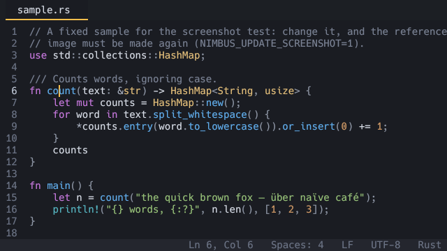

<div align="center">


# Nimbus

**A fast, lightweight, modeless text editor with its own GPU text renderer.**

[](https://github.com/SklorGalore/nimbus/actions/workflows/ci.yml)
[](https://github.com/SklorGalore/nimbus/actions/workflows/release.yml)
[](https://github.com/SklorGalore/nimbus/releases)
[](LICENSE)
<br>
[](https://www.rust-lang.org/)
[](#installation)
[](https://wgpu.rs/)
[](DESIGN.md#5-quality-and-performance-enforcement)
[](CLAUDE.md#code-quality-and-linting)

[Features](#features) ·
[Installation](#installation) ·
[Usage](#usage) ·
[Configuration](#configuration) ·
[Building](#building-from-source) ·
[Roadmap](#roadmap) ·
[Contributing](#contributing)



</div>

## About

Nimbus is a desktop text editor written in Rust. It draws every glyph
itself: text is shaped and rasterized with [swash](https://github.com/dfrg/swash)
into a glyph atlas and drawn with [wgpu](https://wgpu.rs/), inside a
[winit](https://github.com/rust-windowing/winit) window. That keeps it small,
quick to start and the same on macOS, Linux and Windows.

It is modeless: you type to insert, use Cmd (macOS) or Ctrl (elsewhere)
shortcuts, and the mouse works the way you expect. It is aimed at source
code first, then prose and notes in Markdown, then config and data files
and logs.

The [user manual](docs/manual/README.md) covers everything from opening
your first file to themes, languages and key bindings.

Nimbus is a personal tool that is being built in the open, one milestone
at a time. It is usable every day, but it is still pre-1.0: expect rough
edges, and see the [roadmap](#roadmap) for what is coming.

## Features

**Speed and scale**

- First frame in well under the 500 ms budget (about 120 ms warm on an
  Apple M5 Pro, most of it the operating system creating the window).
- Huge files: a 4 GB log opens in a fraction of a second through a
  memory-mapped buffer whose line index is built lazily in the background.
- Rendering on demand only. When nothing changes, Nimbus draws nothing.

**Editing**

- Several cursors: add the next occurrence, add cursors above and below,
  or Alt+click to place them.
- Everyday line and selection operations: duplicate, move and delete
  lines, join lines, toggle comments, select line, smart indentation.
- Undo and redo across every kind of edit, and safe atomic saves.
- Common non-UTF-8 encodings and either line ending, shown in the status
  bar and changeable.
- Soft wrap, a find bar with replace, and Go to Line, Go to File and Go
  to Symbol pickers.

**Code**

- Tree-sitter syntax highlighting for fourteen languages: Rust, C, Go,
  Python, JavaScript, TypeScript, TSX, HTML, CSS, Bash, JSON, TOML, YAML
  and Markdown, with code inside other code (such as fenced blocks in
  Markdown) coloured too.
- Your own languages and highlight queries from the config folder.
- Code folding, from each grammar's fold regions.

**Projects**

- Tabs, a file tree sidebar that lists folders lazily, and a fuzzy file
  opener.
- Find and replace in files, across the whole project folder.
- Split editor groups side by side, sharing the same documents.
- Watches open files and refreshes them when another program changes them,
  and can follow a log that is still being written.
- Remembers your last session and recent files; the sidebar creates,
  renames, moves and deletes files.
- Workspaces made of several folders.

**Compare and merge**

- Two-way compare of any two files, and a three-way merge view that
  resolves conflicts. Both work as `git difftool` and `git mergetool`.

**Look and feel**

- A command palette where every action lives, with its key binding.
- Light and dark themes, plus your own themes that override only what
  they change.
- Font fallback, bold and italic, and a bundled Nerd Font, or any
  installed font with optional ligatures.
- Colour emoji, zoom that is remembered between runs, visible whitespace
  and indent guides.

## Installation

Packages for macOS, Linux and Windows are attached to each
[release](https://github.com/SklorGalore/nimbus/releases):

| System | Package |
|---|---|
| macOS | `.dmg` (drag `Nimbus.app` to Applications), `.zip`, or the Homebrew cask `nimbus.rb` |
| Windows | `nimbus-VERSION-windows-x86_64-setup.exe`, the bare `nimbus.exe` in a `.zip`, or the winget manifest |
| Linux | `.deb` for Debian and Ubuntu, an `.AppImage`, or a tarball with the bare binary |

None is signed (that needs paid developer accounts), so macOS and Windows
warn the first time you open Nimbus. The
[installation guide](docs/manual/getting-started.md#installing) walks
through each package and how to get past that warning once.

To run `nimbus` from a terminal: on macOS the binary is
`/Applications/Nimbus.app/Contents/MacOS/nimbus`, so link it into a
folder on your `PATH`:

```sh
ln -s /Applications/Nimbus.app/Contents/MacOS/nimbus /usr/local/bin/nimbus
```

The Windows installer does not add `nimbus.exe` to your `PATH`; add its
install folder yourself if you want it there. On Linux the `.deb` puts
`nimbus` in `/usr/bin`; with the AppImage or tarball, put it on your
`PATH` yourself.

### Checking a download

Each release has a `SHA256SUMS` file. To check that a download is intact,
put both in one folder and run:

```sh
shasum -a 256 -c SHA256SUMS --ignore-missing   # macOS
sha256sum -c SHA256SUMS --ignore-missing       # Linux
```

On Windows, compare the output of `Get-FileHash FILE` with its line.

A hash proves the file is undamaged; it does not prove who made it. For
that, `SHA256SUMS.minisig` is a [minisign](https://jedisct1.github.io/minisign/)
signature by the release key, whose public half is `minisign.pub` at the
root of this repository (releases made before the key existed have no
signature). With minisign installed (`brew install minisign`,
`apt install minisign`, or `scoop install minisign`):

```sh
minisign -V -p minisign.pub -m SHA256SUMS
```

It prints "Signature and comment signature verified" when the file is
the one that was signed.

### Updates

Nimbus never contacts the network unless you ask it to. "Check for
Updates" in the command palette asks GitHub whether a newer release
exists; see [checking for updates](docs/manual/troubleshooting.md#checking-for-updates)
for the startup option.

## Usage

Open files, folders, or both. A folder becomes the root of the sidebar
and the file opener; each file opens in its own tab.

```sh
nimbus                       # empty window
nimbus notes.md              # one file
nimbus . src/main.rs         # a project folder, with one file open
nimbus --diff old.rs new.rs  # compare two files
nimbus --merge BASE LOCAL REMOTE -o RESULT   # three-way merge
```

`nimbus --help` lists every option, among them `--wrap`, `--find PATTERN`,
`--theme NAME` and `--version`.

### Key bindings

`Primary` is Cmd on macOS and Ctrl on Linux and Windows. Every action is
in the command palette with its current keys, so this is only a start.

| Keys | Action |
|---|---|
| `Primary+Shift+P` | Command palette |
| `Primary+P` | Go to file |
| `Primary+G` | Go to line |
| `Primary+Shift+R` | Go to symbol |
| `Primary+F` | Find |
| `Primary+Shift+F` | Find in files |
| `Primary+D` | Add a cursor at the next occurrence |
| `Primary+Alt+Up` / `Down` | Add a cursor above or below |
| `Primary+L` | Select line |
| `Primary+/` | Toggle comment |
| `Primary+B` | Toggle sidebar |
| `Primary+\` | Split right |
| `Primary+K Primary+0` | Fold all |
| `F12` | Debug overlay (frame time, latency, atlas, buffer backend) |

Any binding can be changed in `config.toml`, including two-chord
bindings such as `Primary+K Primary+L`.

## Configuration

Settings, themes, languages and highlight queries live in the config
folder:

| System | Folder |
|---|---|
| macOS | `~/Library/Application Support/nimbus/` |
| Linux | `~/.config/nimbus/` |
| Windows | `%APPDATA%\nimbus\` |

"Open Config File" in the command palette opens `config.toml`, creating
it from a commented template; "Reload Config" applies your changes. A
mistake costs only the setting that has it and is reported in the
message line. Nimbus never writes `config.toml` itself; window size and
other remembered state go in a separate `state.toml`.

A small example:

```toml
font_size = 15
tab_width = 4
soft_wrap = true
theme = "light"
```

The [user manual](docs/manual/README.md) covers every setting, writing
your own theme, adding a language, indentation rules, key bindings and
changing a language's highlighting.

## Building from source

You need a stable Rust toolchain ([rustup](https://rustup.rs/)). On
Linux, also install the Wayland and xkbcommon headers:

```sh
sudo apt install libwayland-dev libxkbcommon-dev   # Debian and Ubuntu
```

Then:

```sh
git clone https://github.com/SklorGalore/nimbus.git
cd nimbus
cargo build --release
./target/release/nimbus FILE_OR_FOLDER
```

The release profile uses fat LTO, one codegen unit, `panic = "abort"` and
stripping, so a release build takes a while but gives a small, fast
single binary. Debug builds optimize dependencies only and are quick to
iterate on.

Each tree-sitter grammar is a cargo feature of `nimbus-syntax`, all on
by default, so a build can leave out languages it does not need.

## How it works

Nimbus is a Cargo workspace of four crates, with dependencies pointing
only downward:

| Crate | Role |
|---|---|
| [`nimbus-core`](crates/core) | Text buffers (a rope and a memory-mapped piece table behind one `Buffer` trait), edits, undo, cursors, search and diff. No I/O, GPU or windowing, so it is tested headlessly. |
| [`nimbus-syntax`](crates/syntax) | Tree-sitter parsing and highlighting, fed every edit. Large files fall back to fast line-by-line rules. Runs no threads of its own; it hands jobs to the app. |
| [`nimbus-render`](crates/render) | The wgpu surface, glyph atlas, text layout and two instanced pipelines: one for rectangles, one for glyph quads. |
| [`nimbus`](crates/app) | The application: the winit event loop, editor state, panels, key map, actions and config. |

A few rules shape the code:

- Positions are byte offsets into UTF-8, and nothing assumes the whole
  file is in memory.
- The event loop waits for input and redraws only when something
  changed; there is no continuous render loop.
- Every user-visible operation is an action with a stable id, title and
  default keys. The palette, menus and key overrides all come from that
  one registry.

[`DESIGN.md`](DESIGN.md) is the full design: goals and budgets,
architecture, testing, dependencies, open questions and the decision log.

## Performance

These budgets are enforced in CI or measured at every milestone:

| Budget | Target | How it is checked |
|---|---|---|
| Startup | First frame under 500 ms from the top of `main` | `nimbus --smoke` prints `first-frame-ms` |
| Typing latency | Keystroke to pixels within one frame | Debug overlay (`F12`), `--bench-typing N` |
| Huge files | A 4 GB log interactive in under a second | `bench/gen.sh logs` |
| Binary size | Under 35 MB | The `release-size` CI job fails above it |

Each milestone plan in [`docs/milestones/`](docs/milestones) records its
measured startup time and binary size in its Results section.

## Development

```sh
cargo test --workspace                       # all tests
cargo fmt --all --check                      # formatting
RUSTFLAGS="-D warnings" cargo clippy --workspace --all-targets   # lints, as CI runs them
cargo run -- FILE --headless 1600x1000 --screenshot /tmp/f.bmp   # render without a window
bench/gen.sh                                 # generate the 10 MB and 100 MB bench files
cargo test --release -p nimbus-core -- --ignored --nocapture     # opt-in benchmarks
```

The lints are strict: clippy pedantic, no `unwrap`, `expect` or `panic!`
outside tests, documentation on every public item, and `unsafe` denied
except in the renderer and the memory-mapped buffer, where each block
states why it is sound. [`CLAUDE.md`](CLAUDE.md) has the full rule set
and the complete list of development commands.

CI ([`ci.yml`](.github/workflows/ci.yml)) runs formatting, clippy and
tests on macOS, Ubuntu and Windows, `cargo deny` for dependency licences
and advisories, and the release binary size check, on every push and
pull request.

## Roadmap

Nimbus grows in milestones, each with a plan, a done-when checklist and
measured results. The full table is in
[`docs/milestones/README.md`](docs/milestones/README.md).

| Milestones | Status |
|---|---|
| M0 to M13: scaffold, GPU text, editing, tabs, highlighting, file tree, huge files, polish, compare and merge, find in files, everyday editing, workspace, splits and folding | Done |
| M15 distribution, M16 rendering second pass, M17 encodings and line endings, M18 compare second pass, M19 workspace and search second pass | Done |
| M14 languages, second pass | In progress |
| M20 reading aids, such as a minimap | Planned |
| M21 foundations and 1.0 | Planned |

Some things are deliberately out of scope for now: a Vim mode, plugins,
LSP, terminals, collaborative editing and right-to-left text. See
[`DESIGN.md` §2](DESIGN.md#2-non-goals-for-now) for the full list and
the reasons.

## Contributing

Bug reports and ideas are welcome as
[issues](https://github.com/SklorGalore/nimbus/issues). For a code
change:

1. Read [`DESIGN.md`](DESIGN.md) and the plan for the milestone your
   change belongs to in [`docs/milestones/`](docs/milestones).
2. Make the change on a branch, with tests next to the code
   (`#[cfg(test)] mod tests` in the same file).
3. Run `cargo fmt --all`, strict clippy and `cargo test --workspace`
   before opening a pull request; CI runs the same on all three
   platforms.
4. Add a line to the "Unreleased" section of
   [`CHANGELOG.md`](CHANGELOG.md) for anything a user would notice.

A new dependency needs a reason in the commit message and has to fit the
binary-size budget.

## Releasing

Set the version in `Cargo.toml` (`[workspace.package]`), move the
`CHANGELOG.md` "Unreleased" notes under a heading for that version,
commit, then push a tag with that version, such as `v0.8.0`. The release
workflow ([`release.yml`](.github/workflows/release.yml)) builds every
platform, makes a draft release with the packages, the Homebrew cask,
the winget manifest and `SHA256SUMS` attached, and signs the checksums;
publish it on GitHub when it looks right.

<details>
<summary>Packaging scripts and signing setup</summary>

The packaging steps are `scripts/bundle-macos.sh`,
`scripts/dmg-macos.sh`, `scripts/deb-linux.sh`,
`scripts/appimage-linux.sh`, `packaging/windows/nimbus.iss` and
`scripts/manifests.sh`. The app icon is drawn by `scripts/make-icons.py`.

Signing `SHA256SUMS` needs a one-time setup: run `minisign -G -W` (no
password, since the key lives in a secret), commit the public key as
`minisign.pub`, and put the secret key file's contents in the
repository's `MINISIGN_SECRET_KEY` Actions secret. Until then the
workflow says the signing step was skipped and the release has no
`.minisig`.

The cask and winget manifest are attached for copying on: the cask goes
in a tap (`Casks/nimbus.rb` in a `homebrew-TAP` repository) and the
manifest in a pull request to `microsoft/winget-pkgs`.

</details>

## License

Nimbus is released under the [MIT License](LICENSE). The bundled font,
Hack Nerd Font Mono, has its own licence
([`crates/render/assets/HackNerdFont-LICENSE.md`](crates/render/assets/HackNerdFont-LICENSE.md));
both ship with every release.

## Acknowledgements

Nimbus stands on [wgpu](https://wgpu.rs/),
[winit](https://github.com/rust-windowing/winit),
[swash](https://github.com/dfrg/swash),
[ropey](https://github.com/cessen/ropey),
[tree-sitter](https://tree-sitter.github.io/),
[nucleo](https://github.com/helix-editor/nucleo),
[imara-diff](https://github.com/pascalkuthe/imara-diff) and
[muda](https://github.com/tauri-apps/muda), and on the
[Hack](https://sourcefoundry.org/hack/) and
[Nerd Fonts](https://www.nerdfonts.com/) projects.
