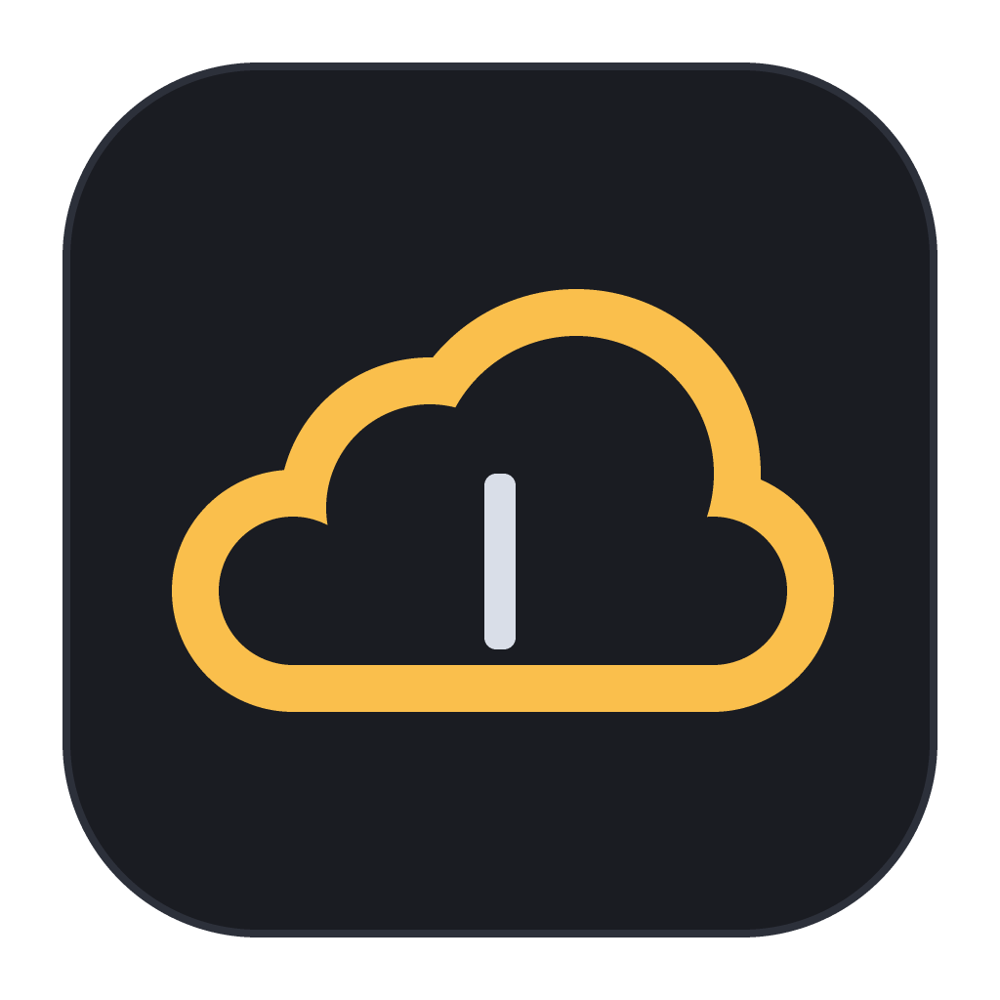
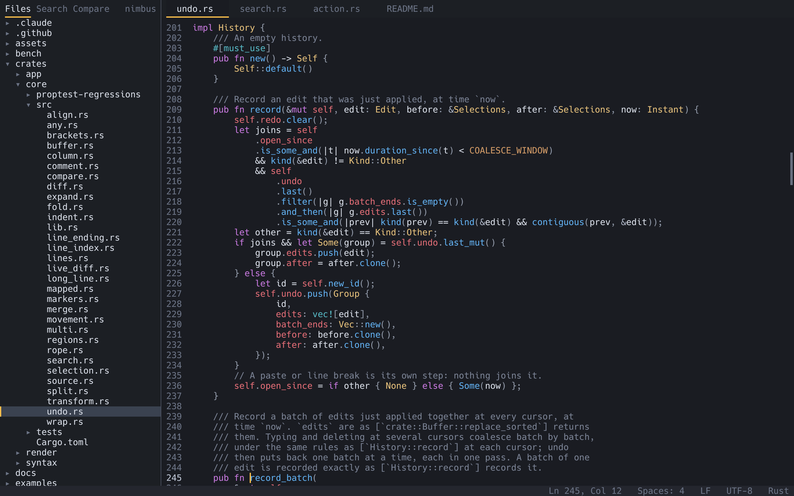
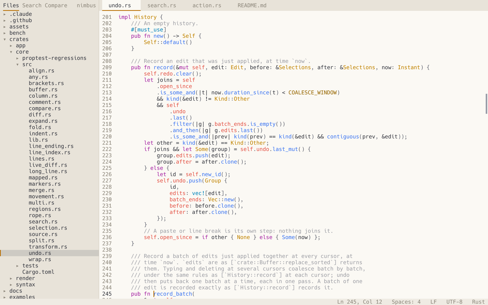
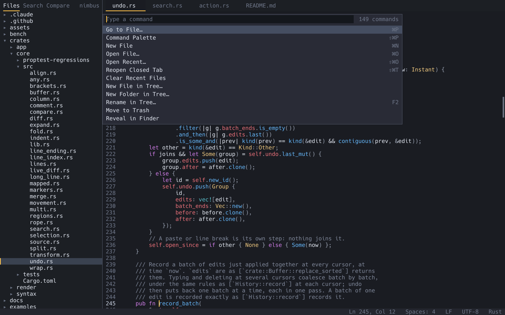
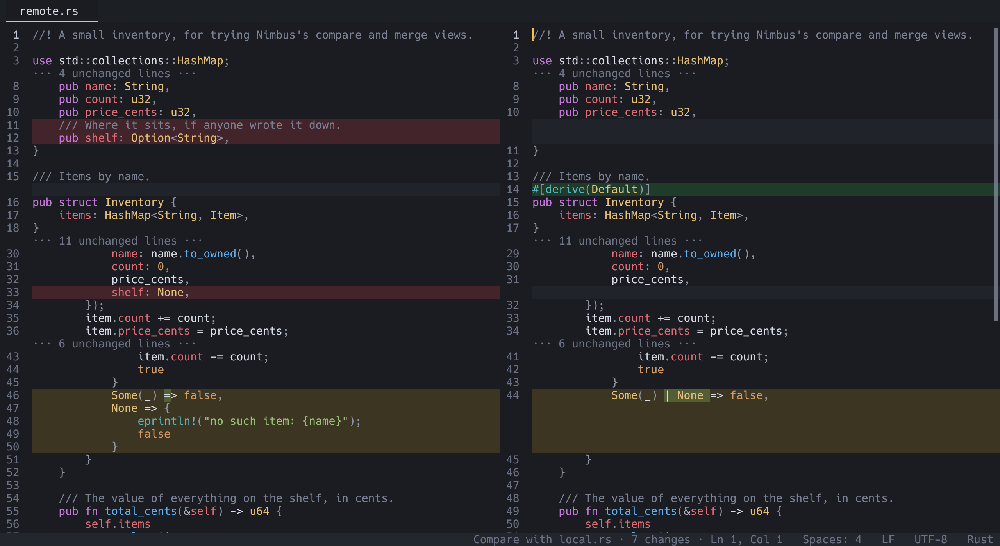
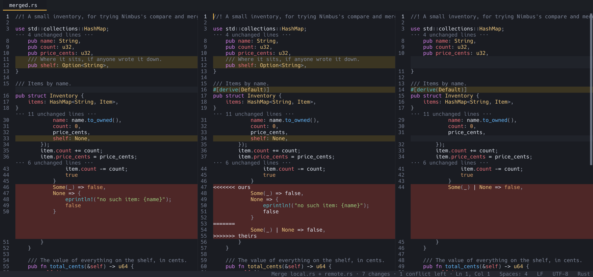
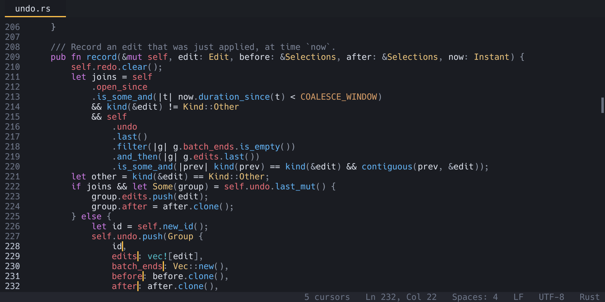
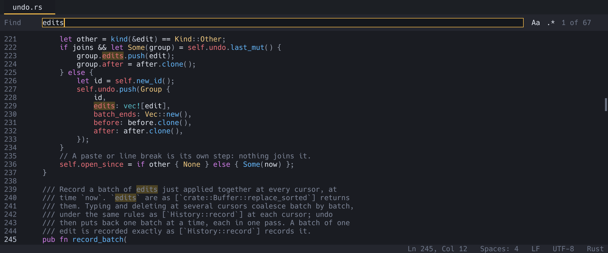
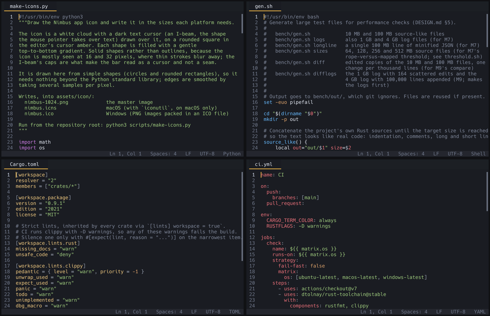
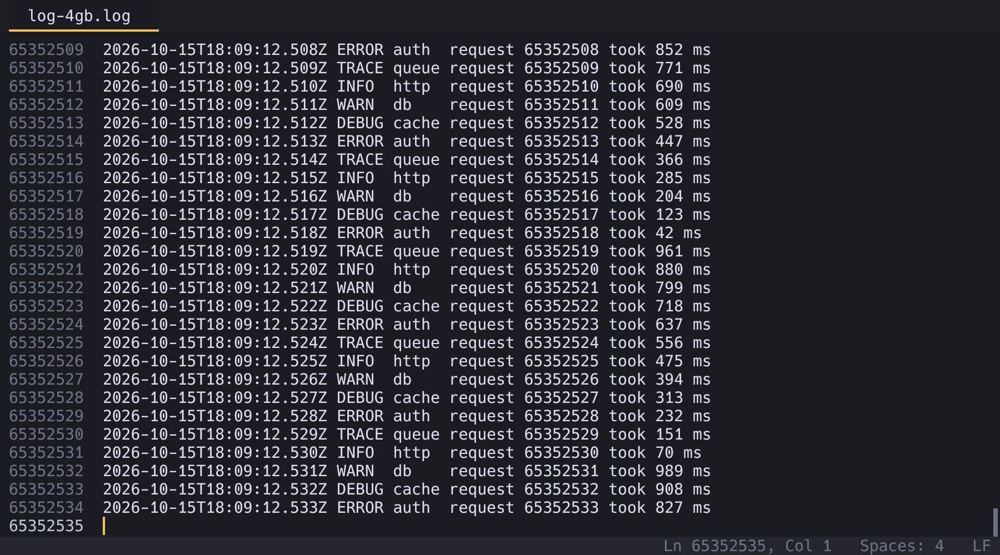

<div align="center">



# Nimbus

**A fast, lightweight text editor for macOS, Linux and Windows, with its own GPU text renderer.**

[](https://github.com/SklorGalore/nimbus/actions/workflows/ci.yml)
[](https://github.com/SklorGalore/nimbus/releases)
[](LICENSE)
[](https://www.rust-lang.org/)
[](#installation)

[Features](#features) ·
[Installation](#installation) ·
[Usage](#usage) ·
[Configuration](#configuration) ·
[Building](#building-from-source) ·
[Roadmap](#roadmap) ·
[Contributing](#contributing)



</div>

## About

Nimbus is a desktop text editor written in Rust. It opens in a blink,
handles multi-gigabyte files, and stays out of your way: you type to
insert, use the usual Cmd (macOS) or Ctrl shortcuts, and the mouse works
as you expect. There are no modes to learn.

Nimbus draws every glyph itself. Text is rasterized with
[swash](https://github.com/dfrg/swash) into a glyph atlas and drawn on
the GPU with [wgpu](https://wgpu.rs/), so the editor is small, starts
quickly and looks the same on every platform.

It is built for source code first, then Markdown prose and notes, then
config files, data and logs.

Nimbus 1.0 is out: everything in the [roadmap](#roadmap)'s plan has
landed, and the editing path is fuzz-tested and soak-tested. The [user manual](docs/manual/README.md) covers everything
from opening your first file to themes, languages and key bindings.

## Features

**Fast at any size**

- Starts in a fraction of a second, with most of that time spent by the
  operating system opening the window.
- Opens a 4 GB log almost instantly by mapping it from disk and counting
  its lines in the background.
- Draws only when something changes, so an idle window uses no CPU or
  GPU time.

**Editing**

- Multiple cursors: add the next occurrence, add cursors above and below,
  or Alt+click to place them.
- Line and selection commands: duplicate, move and delete lines, join
  lines, toggle comments, select line, and smart indentation.
- Undo and redo for every kind of edit, and atomic saves that never leave a
  half-written file.
- Common non-UTF-8 encodings and both line endings, shown in the status
  bar and changeable.
- Soft wrap, find and replace, and pickers for Go to Line, Go to File
  and Go to Symbol.

**Code**

- Tree-sitter syntax highlighting for Rust, C, Go, Python, JavaScript,
  TypeScript, TSX, HTML, CSS, Bash, JSON, TOML, YAML and Markdown,
  including code embedded in other code, such as fenced blocks in
  Markdown.
- Add your own languages and highlight queries.
- Code folding based on each language's structure.

**Projects**

- Tabs, a file tree sidebar, and a fuzzy file finder.
- Find and replace across every file in a project.
- Side-by-side editor groups that share the same documents.
- Workspaces made of several folders.
- Your last session and recent files come back when you reopen Nimbus;
  create, rename, move and delete files from the sidebar.
- Open files refresh when another program changes them, and a log that
  is still being written can be followed as it grows.

**Compare and merge**

- Compare any two files side by side, or resolve a three-way merge.
  Both work as `git difftool` and `git mergetool`.
- Ignore whitespace, case or blank lines; compare two folders; compare
  a file with HEAD or any git revision. Minified one-line files are
  compared in pieces, so a small edit shows as a small change.

**Look and feel**

- A command palette that lists every action with its key binding.
- Light and dark themes, plus your own themes that change only what
  they need to.
- Any installed font, with optional ligatures, font fallback, bold and
  italic, and color emoji. A Nerd Font is bundled.
- Zoom that is remembered between sessions, visible whitespace and
  indent guides.
- Sticky scroll keeps the function or section you are in pinned at the
  top; an optional minimap shows the lines around the view.
- A Markdown preview beside the file that follows as you type and
  scroll, with code blocks colored like the editor's.
- An optional proportional font, such as Inter or SF Pro, for the
  sidebar, tabs, status bar and pickers, while the text stays monospace.

## Screenshots

<table>
<tr>
<td width="50%"><br><sub>The built-in light theme</sub></td>
<td width="50%"><br><sub>Every command in the palette, with its keys</sub></td>
</tr>
<tr>
<td><br><sub>Compare two files; unchanged runs fold away</sub></td>
<td><br><sub>Three-way merge, with the result in the middle</sub></td>
</tr>
<tr>
<td><br><sub>Several cursors, one undo step</sub></td>
<td><br><sub>Find in the current file</sub></td>
</tr>
<tr>
<td><br><sub>Fourteen languages built in</sub></td>
<td><br><sub>A 4 GB log, all 65 million lines counted</sub></td>
</tr>
</table>

## Installation

Download Nimbus from the
[releases page](https://github.com/SklorGalore/nimbus/releases).

| System | Download |
|---|---|
| macOS | `Nimbus-VERSION-macos.zip`, containing `Nimbus.app` |
| Windows | `nimbus-VERSION-windows-x86_64.zip`, containing `nimbus.exe` |
| Linux | `nimbus-VERSION-linux-x86_64.tar.gz`, containing the `nimbus` binary |

> [!NOTE]
> From v1.0.0 on, each release also has a macOS `.dmg` and Homebrew
> cask, a Windows installer and winget manifest, and a Linux `.deb` and
> AppImage.

The builds are not code-signed yet, so macOS and Windows show a warning
the first time you open Nimbus. On macOS, right-click `Nimbus.app` and
choose Open, or run:

```sh
xattr -d com.apple.quarantine /Applications/Nimbus.app
```

On Windows, when SmartScreen says "Windows protected your PC", click
"More info", then "Run anyway". The
[installation guide](docs/manual/getting-started.md#installing) covers
each package in detail.

### Running from a terminal

On macOS, the command-line binary is inside the app bundle. Link it into
a folder on your `PATH`:

```sh
ln -s /Applications/Nimbus.app/Contents/MacOS/nimbus /usr/local/bin/nimbus
```

On Windows and Linux, put `nimbus.exe` or `nimbus` in a folder on your
`PATH`.

### Verifying a download

Each release includes a `SHA256SUMS` file. Put it in the same folder as
your download and run:

```sh
shasum -a 256 -c SHA256SUMS --ignore-missing   # macOS
sha256sum -c SHA256SUMS --ignore-missing       # Linux
```

On Windows, compare the output of `Get-FileHash FILE` with the matching
line in `SHA256SUMS`.

A matching hash shows the file arrived intact. When a release also
includes `SHA256SUMS.minisig`, you can confirm it was signed by the
project's release key with [minisign](https://jedisct1.github.io/minisign/)
and `minisign.pub` from the root of this repository:

```sh
minisign -V -p minisign.pub -m SHA256SUMS
```

### Updates

Nimbus never connects to the network unless you ask it to. Run "Check
for Updates" from the command palette to see whether a newer release is
available, or turn on the check at startup as described in
[checking for updates](docs/manual/troubleshooting.md#checking-for-updates).

## Usage

Open files, folders, or both. A folder becomes the root of the sidebar
and the file finder, and each file opens in its own tab.

```sh
nimbus                       # empty window
nimbus notes.md              # one file
nimbus . src/main.rs         # a project folder, with one file open
nimbus --diff old.rs new.rs  # compare two files
nimbus --diff dir-a dir-b    # compare two folders
nimbus --merge BASE LOCAL REMOTE -o RESULT   # three-way merge
```

Run `nimbus --help` to see every option, such as `--wrap`,
`--find PATTERN`, `--theme NAME` and `--version`.

### Key bindings

`Primary` means Cmd on macOS and Ctrl on Linux and Windows. These are
the most common bindings; the command palette shows the rest.

| Keys | Action |
|---|---|
| `Primary+Shift+P` | Command palette |
| `Primary+P` | Go to file |
| `Primary+G` | Go to line |
| `Primary+Shift+R` | Go to symbol |
| `Primary+F` | Find |
| `Primary+Shift+F` | Find in files |
| `Primary+D` | Add a cursor at the next occurrence |
| `Primary+Alt+Up` / `Down` | Add a cursor above or below |
| `Primary+L` | Select line |
| `Primary+/` | Toggle comment |
| `Primary+B` | Toggle sidebar |
| `Primary+\` | Split right |
| `Primary+K Primary+0` | Fold all |
| `Primary+Shift+V` | Markdown preview |

You can change any binding in `config.toml`, including two-step chords
such as `Primary+K Primary+L`. See the
[key bindings reference](docs/manual/keybindings.md).

## Configuration

Settings, themes, languages and highlight queries live in your config
folder:

| System | Folder |
|---|---|
| macOS | `~/Library/Application Support/nimbus/` |
| Linux | `~/.config/nimbus/` |
| Windows | `%APPDATA%\nimbus\` |

Run "Open Config File" from the command palette to open `config.toml`.
The first time, it is created with every setting listed and commented.
Run "Reload Config" to apply your changes. If a setting has a mistake,
Nimbus reports it and keeps the rest.

```toml
font_size = 15
tab_width = 4
soft_wrap = true
theme = "light"
```

The [user manual](docs/manual/README.md) covers every setting, custom
themes, adding languages, indentation and highlighting.

## Building from source

Install a stable Rust toolchain with [rustup](https://rustup.rs/). On
Debian and Ubuntu, also install the Wayland and xkbcommon headers:

```sh
sudo apt install libwayland-dev libxkbcommon-dev
```

Then build and run:

```sh
git clone https://github.com/SklorGalore/nimbus.git
cd nimbus
cargo build --release
./target/release/nimbus FILE_OR_FOLDER
```

Release builds are fully optimized, so they take a while to compile. Debug builds
(`cargo build`) are much quicker to compile and still fast to run.

Each language grammar is a cargo feature of `nimbus-syntax`. All are on
by default; turn off the ones you don't need for a smaller binary.

## How it works

Nimbus is a Cargo workspace of four crates:

| Crate | Role |
|---|---|
| [`nimbus-core`](crates/core) | Text buffers (an in-memory rope and a memory-mapped piece table for huge files), edits, undo, cursors, search and diff. No I/O, GPU or windowing code. |
| [`nimbus-syntax`](crates/syntax) | Tree-sitter parsing and highlighting, with a fast line-by-line fallback for very large files. |
| [`nimbus-render`](crates/render) | The GPU renderer: the wgpu surface, glyph atlas, text layout and drawing pipelines. |
| [`nimbus`](crates/app) | The application: the window and event loop, editor state, panels, key map, actions and config. |

Each crate depends only on the ones above it in this table. Every command
in the editor is a named action, so the command palette, menus and key
bindings all come from one list. [`DESIGN.md`](DESIGN.md) describes the
architecture in depth.

## Performance

Nimbus is held to these targets:

| Target | Goal |
|---|---|
| Startup | First frame in under 500 ms |
| Typing | Each keystroke on screen within one frame |
| Huge files | A 4 GB log usable in under a second |
| Size | A single binary under 35 MB, enforced in CI |

`nimbus --smoke` prints the time to first frame, and the debug overlay
(`F12`) shows frame time and keystroke latency.

## Development

```sh
cargo test --workspace                                          # all tests
cargo fmt --all --check                                         # formatting
RUSTFLAGS="-D warnings" cargo clippy --workspace --all-targets  # lints, as CI runs them
cargo run -- FILE --headless 1600x1000 --screenshot /tmp/f.bmp  # render without a window
bench/gen.sh                                                    # generate large test files
scripts/screenshots.sh                                          # remake the README and manual screenshots
```

The lints are strict: no `unwrap`, `expect` or `panic!` outside tests,
documentation on every public item, and `unsafe` only where it is
unavoidable, with a comment explaining why each use is sound.

[CI](.github/workflows/ci.yml) runs formatting, lints and tests on
macOS, Linux and Windows, checks dependency licenses and security
advisories, and enforces the binary size limit on every push and pull
request.

## Roadmap

<!-- Mirrors the status column of docs/milestones/README.md. When a
milestone lands on development, move its line up to "Available now". -->

**Available now**

- GPU text rendering, editing, tabs, syntax highlighting and the file tree
- Huge files, multiple cursors, compare and merge
- Find in files and everyday editing commands
- Session restore and file management
- Split views and code folding
- Installers and packages for every platform
- Rendering polish: color emoji, ligatures and zoom
- Text encodings and line endings
- Multi-folder workspaces and search history
- Compare, second pass: ignore whitespace, compare folders and minified
  files, and Compare with HEAD
- Reading aids: sticky scroll, a minimap, a Markdown preview and an
  interface font
- Languages, second pass: better Markdown and embedded code
- Foundations for 1.0: fuzzing, a soak test and a crash record

**After 1.0**

- Screen-reader support
- Newer versions of the text and window libraries (ropey 2, winit 0.31)
  once they are stable
- Compatibility mode: Nimbus keeps working on machines without a usable
  GPU, drawing on the CPU instead

Some things are out of scope for now, including a Vim mode, plugins,
LSP, a built-in terminal, collaborative editing and right-to-left text.
[`DESIGN.md`](DESIGN.md#2-non-goals-for-now) explains why. The detailed
plan for each stage is in [`docs/milestones/`](docs/milestones/README.md).

## Contributing

Bug reports and feature ideas are welcome as
[issues](https://github.com/SklorGalore/nimbus/issues). For a larger
change, please open an issue first so we can agree on the approach.

When you send a pull request:

1. Put tests next to the code they cover, in a `#[cfg(test)] mod tests`
   block in the same file.
2. Run `cargo fmt --all`, the strict clippy command above, and
   `cargo test --workspace`. CI runs the same checks on all three
   platforms.
3. Add a line to the "Unreleased" section of
   [`CHANGELOG.md`](CHANGELOG.md) for anything users will notice.
4. Explain any new dependency in the commit message; the binary has a
   size limit to stay within.

Maintainers cutting a release can follow [`docs/releasing.md`](docs/releasing.md).

## License

Nimbus is released under the [MIT License](LICENSE). The bundled Hack
Nerd Font Mono has its
[own license](crates/render/assets/HackNerdFont-LICENSE.md).

## Acknowledgements

Nimbus is built on [wgpu](https://wgpu.rs/),
[winit](https://github.com/rust-windowing/winit),
[swash](https://github.com/dfrg/swash),
[ropey](https://github.com/cessen/ropey),
[tree-sitter](https://tree-sitter.github.io/),
[nucleo](https://github.com/helix-editor/nucleo),
[imara-diff](https://github.com/pascalkuthe/imara-diff) and
[muda](https://github.com/tauri-apps/muda), and uses the
[Hack](https://sourcefoundry.org/hack/) font with
[Nerd Fonts](https://www.nerdfonts.com/) glyphs.
