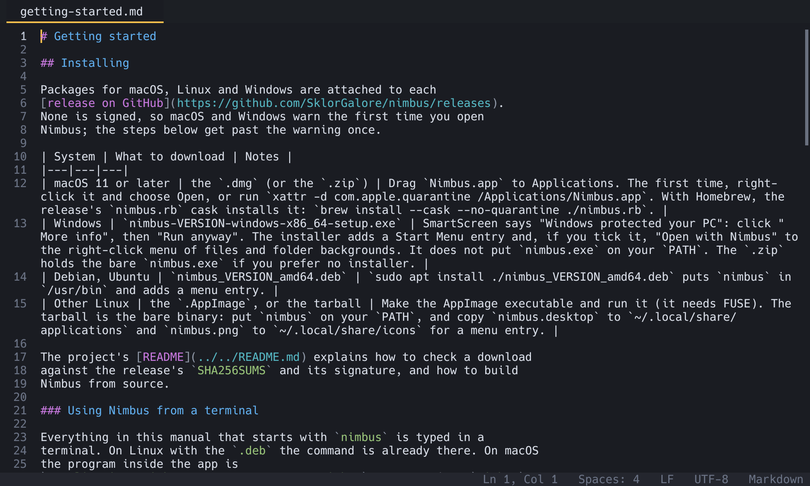

# Editing

Nimbus is modeless: type and the text changes. This chapter covers moving
around, selecting, several cursors, the clipboard, undo, indentation,
comments and the line and text operations. Every operation here works
with several cursors at once and undoes in one step. The full list of
keys is in [Keyboard shortcuts and commands](keybindings.md).

## Moving the cursor

| Move | macOS | Windows and Linux |
|---|---|---|
| By character or line | arrow keys | arrow keys |
| By word | `Option+Left`, `Option+Right` | `Ctrl+Left`, `Ctrl+Right` |
| To line start or end | `Home`, `End`, `Cmd+Left`, `Cmd+Right` | `Home`, `End` |
| By screen | `PageUp`, `PageDown` | `PageUp`, `PageDown` |
| To start or end of file | `Cmd+Up`, `Cmd+Down` (also `Cmd+Home`, `Cmd+End`, `Ctrl+Home`, `Ctrl+End`) | `Ctrl+Home`, `Ctrl+End`, `Ctrl+Up`, `Ctrl+Down` |

- Left and Right move by whole *graphemes*, what you see as one
  character, so an accented letter or a family emoji is one step.
- Up and Down remember the column you started from, across shorter
  lines, tabs and wide characters.
- Word movement stops at code-style boundaries: `.` and `(` split words.
- Home goes to the first non-blank character of the line; press it again
  for column 0.
- Clicking places the cursor, also past the end of a line. The mouse
  wheel and trackpad scroll, sideways too for long lines. Drag the
  scrollbar's thumb or click its track to jump.
- With [soft wrap](#soft-wrap) on, Up and Down move by screen row.

## Selecting

- Hold **Shift** with any movement key to extend the selection.
- **Drag** with the mouse to select. **Double-click** selects a word,
  **triple-click** a line; dragging after a double- or triple-click
  extends by words or lines. **Shift+click** extends the selection to
  the click.
- **Select All**: `Cmd+A` / `Ctrl+A`.
- **Select Line**: `Cmd+L` / `Ctrl+L` selects the cursor's line; press
  it again to add the next line.
- **Expand Selection**: `Ctrl+Shift+Right` / `Alt+Shift+Right` grows the
  selection one step at a time. In a file with a syntax tree (see
  [Languages](languages.md)) the steps follow the code: the word, the
  inside of a string or brackets, the expression, the statement, the
  block, the function, the line, the whole file. Without a tree (plain
  text, huge files) it goes word, the nearest quotes or bracket pair,
  line, file. **Shrink Selection** (`Ctrl+Shift+Left` /
  `Alt+Shift+Left`) retraces the steps until you move the cursor.
- **Select to Matching Bracket** (palette) selects from the bracket next
  to the cursor to its partner.

The bracket pair around the cursor is always outlined, and where the file
has a syntax tree, brackets inside strings and comments are ignored.

## Several cursors

Most editing in Nimbus works with any number of cursors at once.

| To | macOS | Windows and Linux |
|---|---|---|
| Add a cursor at the next occurrence of the selection | `Cmd+D` | `Ctrl+D` |
| Add a cursor on the line above or below | `Cmd+Option+Up`, `Cmd+Option+Down` | `Ctrl+Alt+Up`, `Ctrl+Alt+Down` |
| Add a cursor, or remove one, with the mouse | `Option`+click | `Alt`+click |
| Column selection | `Shift+Option`+drag | `Shift+Alt`+drag |
| Back to one cursor | `Escape` | `Escape` |

- **Add Next Occurrence** with nothing selected selects the word under
  the cursor first; each further press adds the next place that text
  appears, wrapping around the end of the file and skipping places
  already selected. The message line says when every occurrence is
  selected or there is no other. In a huge file each press looks at most
  32 MB ahead; press again to look further.
- **Option+click / Alt+click** on an existing cursor removes it. A new
  cursor can be dragged out into a selection.
- **Column selection** puts a cursor (or a selection, if you drag
  sideways) on every line between the press and the pointer, by screen
  column. Lines too short to reach that column are skipped. It covers at
  most 10,000 lines.
- Typing, deleting, movement, paste and every operation in this chapter
  apply to all cursors, and undo restores all of them.
- The status bar shows how many cursors there are.

Some Windows graphics drivers use `Ctrl+Alt+Up` and `Ctrl+Alt+Down` to
rotate the screen. If yours does, use the palette or rebind the keys.

## Typing and deleting

- **Enter** inserts the file's own line ending (LF or CRLF) and keeps the
  line's indentation. After an opening bracket the new line is indented
  one level more, and if the closing bracket was right after the cursor
  it moves to a line of its own below.
- **Tab** inserts one level of indentation, or, with a selection over
  several lines, indents those lines. **Shift+Tab** outdents.
- **Backspace** and **Delete** remove one grapheme, or the selection. A
  CRLF line ending is removed as one unit.
- Delete a word backward or forward with `Option+Backspace` and
  `Option+Delete` / `Ctrl+Backspace` and `Ctrl+Delete`. On macOS,
  `Cmd+Backspace` deletes to the start of the line.
- **Auto-pairs**: typing `(`, `[`, `{`, `"`, `'` or a backtick also
  inserts the closing character, when the next character is a space, a
  closing bracket, `;`, `,` or the end of the line. Typing the closer
  steps over it, Backspace inside an empty pair removes both, and typing
  an opener with text selected wraps the selection. Quotes do not pair
  right after a letter, so `don't` stays `don't`. Auto-pairs are on for
  code and off for Markdown and plain text; the `auto_pairs` setting
  changes that (see [Settings](settings.md#editor)).
- A **closing bracket** typed first on a line moves the line back to line
  up with its opening bracket.
- **Input methods** (accents with dead keys, Chinese, Japanese and so on)
  work: the text being composed is underlined at the cursor.

## Clipboard

Cut, Copy and Paste are `Cmd+X`, `Cmd+C`, `Cmd+V` / `Ctrl+X`, `Ctrl+C`,
`Ctrl+V`, using the system clipboard.

- With nothing selected, Copy and Cut do nothing.
- With several cursors, Copy puts each selection on its own line. Pasting
  text with exactly one line per cursor puts one line at each cursor;
  otherwise every cursor gets the whole text.
- Pasted line endings are converted to the file's own.
- Copy and Cut take at most 64 MB; a larger selection is refused with a
  message, and Cut then deletes nothing.

## Undo and redo

Undo is `Cmd+Z` / `Ctrl+Z`; Redo is `Cmd+Shift+Z` / `Ctrl+Shift+Z`, and
also `Ctrl+Y` on Windows and Linux. Undo restores the text and the
cursors. A run of typing undoes a word at a time, and each operation in
this chapter is one step however many cursors it touched. In the find
bar or another text field, undo applies to that field.

## Lines and text

| Command | macOS | Windows and Linux | What it does |
|---|---|---|---|
| Duplicate Line or Selection | `Cmd+Shift+D` | `Ctrl+Shift+D` | Copies the selection, or the cursor's line, right after itself. |
| Move Line Up / Down | `Option+Up`, `Option+Down` | `Alt+Up`, `Alt+Down` | Moves the selected lines past their neighbour. |
| Delete Line | `Cmd+Shift+K` | `Ctrl+Shift+K` | Deletes the selected lines. |
| Join Lines | `Cmd+J` | `Ctrl+J` | Joins the selected lines (or the cursor's line and the next). |
| Insert Line Below | `Cmd+Enter` | `Ctrl+Enter` | Opens a new line below without splitting the current one. |
| Insert Line Above | `Cmd+Shift+Enter` | `Ctrl+Shift+Enter` | Opens a new line above. |
| Transform to Upper / Lower / Title Case | palette | palette | Changes the case of the selection. |
| Sort Lines, Sort Lines Reversed | palette | palette | Sorts the selected lines, or the whole file when nothing is selected. |
| Remove Duplicate Lines | palette | palette | Keeps the first of each repeated line, in the selection or the whole file. |
| Trim Trailing Whitespace | palette | palette | Removes spaces and tabs at line ends, in the selection or the whole file. |

Line operations read only the lines they change, so they are quick even
in a huge file. They refuse a selection over 64 MB with the message
"Selection too large for this operation".

On some Linux desktops the window manager takes `Alt+Up` and `Alt+Down`;
rebind Move Line Up and Down in the config, or use the palette.

## Comments

- **Toggle Line Comment** (`Cmd+/` / `Ctrl+/`) comments or uncomments
  the selected lines with the language's line comment (`//`, `#`, `--`
  and so on). Blank lines are skipped and the comment marker lines up
  with the least indented line. If the lines are already commented, it
  uncomments them.
- **Toggle Block Comment** (`Cmd+Shift+/` / `Ctrl+Shift+/`) wraps each
  selection in the language's block comment (`/* */`, `<!-- -->`), or
  unwraps it.
- A language without a line comment, such as Markdown, HTML or CSS, uses
  its block comment for both. Plain text has none, and the message line
  says so. Your [own languages](customizing.md#your-own-languages) use the
  comment markers you give them.

## Indentation

When a file opens, Nimbus looks at its first 4,000 lines and uses the
indentation it finds: tabs, or the most common number of spaces. Files
that do not say (new or unindented files) use your settings, four spaces
by default. The status bar shows the result as `Spaces: 4` or `Tabs`.

Click that item, or use these palette commands, to change it for the
current file:

- **Indent Using Spaces** and **Indent Using Tabs**
- **Detect Indentation from File** looks at the file again.

Tab, Shift+Tab, Enter after an opening bracket, and a closing bracket
typed first on a line all follow this setting. The `[indent]` settings
change the defaults and can turn detection off, per language if you like
(see [Settings](settings.md#indent)). The separate `tab_width` setting
only says how wide a tab character is drawn.

## Soft wrap

Toggle Soft Wrap (`Option+Z` / `Alt+Z`) wraps long lines at word
boundaries to fit the window, for the current tab only. Up and Down then
move by screen row, and the top line stays put when you resize the
window. New tabs start with wrap on or off according to the `soft_wrap`
setting; Markdown files start wrapped unless you set otherwise (see
[Settings](settings.md#editor)). `nimbus --wrap` starts every tab
wrapped.

## Saving

Save (`Cmd+S` / `Ctrl+S`) writes the file atomically. Save As…
(`Cmd+Shift+S` / `Ctrl+Shift+S`) picks a new name. Nimbus keeps the
file's encoding, its line endings, a byte order mark if it had one, and
any bytes it could not read as text, so a file you open and save without
editing comes back byte for byte. If the file's encoding cannot hold a
character you typed, the save stops and offers to save as UTF-8 instead;
Save with Encoding and Change Line Endings convert a file on purpose.
See [Encodings and line endings](encodings.md).

Two settings change the file on save, both off by default:
`trim_trailing_whitespace` and `final_newline` (see
[Settings](settings.md#editor)). Neither applies to huge files.
