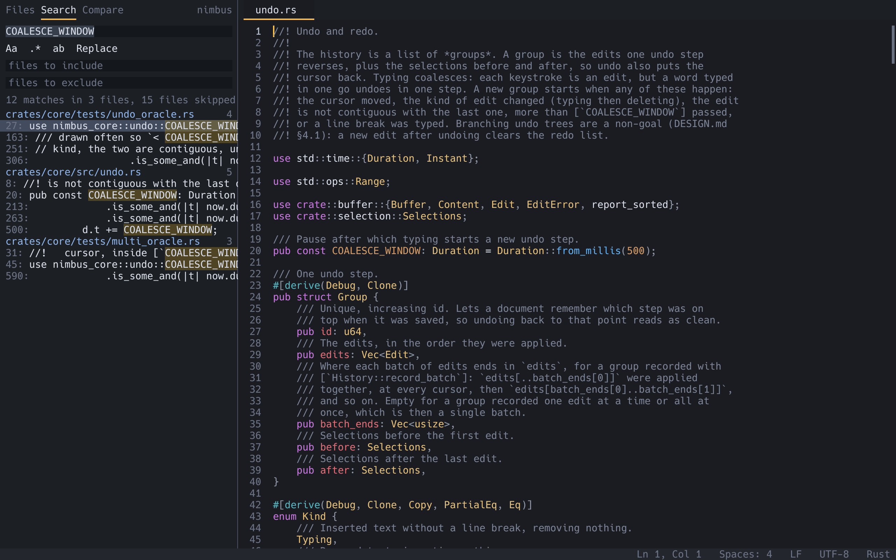

# Find and replace

Nimbus has two searches: the **find bar**, for the file in front of you,
and **Find in Files**, for the whole project folder, in the sidebar.

## Find in the current file

Find (`Cmd+F` / `Ctrl+F`) opens the find bar at the top of the text.
Replace (`Cmd+Option+F` / `Ctrl+H`) opens it with a second row for the
replacement. If you had a short selection on one line, it becomes the
search text.

The search runs as you type: every match on screen is highlighted, the
current one more strongly, and the cursor jumps to the first match after
where you started. The bar shows the count, such as `3 of 120`, or `no
matches`.

| In the find bar | macOS | Windows and Linux |
|---|---|---|
| Next match | `Enter` | `Enter` |
| Previous match | `Shift+Enter` | `Shift+Enter` |
| Match case on or off | `Option+C` | `Alt+C` |
| Regular expression on or off | `Option+R` | `Alt+R` |
| Switch between the find and replace fields | `Tab` | `Tab` |
| Replace this match and go to the next (in the replace field) | `Enter` | `Enter` |
| Replace all matches | `Cmd+Enter` | `Ctrl+Enter` |
| Close the bar | `Escape` | `Escape` |

- Matching ignores case until you turn Match case on.
- **Regular expressions** use the syntax of Rust's `regex` crate, which
  is close to Perl's without look-around. A pattern that does not parse
  shows its error in the bar. In the replacement, `$1`, `${name}` and
  `$0` insert what the pattern's groups matched.
- **Replace All** is one undo step. It refuses when there are more than
  250,000 matches (narrow the search first).
- Clicking in the text gives it the keyboard while leaving the bar open,
  and matches stay highlighted; click a field of the bar to go back.
  After you edit the text, the search runs again once you pause.
- `Option+C`, `Option+R` (and `Alt+C`, `Alt+R`) belong to the find bar
  only while it is open. When it is closed they type their usual
  characters, such as `ç` on a Mac.
- Each [group](window.md#groups-tabs-side-by-side) has its own find bar.
- Files of 1 MB or more are searched in the background, with results
  streaming in, so typing never waits. In a huge file, Replace All waits
  until the count is final.

`nimbus FILE --find PATTERN` opens a file with the find bar already
searching.

## Find in files

Find in Files (`Cmd+Shift+F` / `Ctrl+Shift+F`) shows the sidebar's
**Search** panel with the keyboard in its query field. A short one-line
selection becomes the query. Replace in Files (`Cmd+Shift+H` /
`Ctrl+Shift+H`) does the same with the replacement field shown.

The panel has, from the top:

- the **query**, and below it a row of toggles: `Aa` match case, `.*`
  regular expression, `ab` whole words only, and `Replace` to show the
  replacement field. Rest the pointer on a toggle to see what it does;
- the **replacement** field (when Replace is on);
- **files to include** and **files to exclude**: comma-separated globs
  such as `*.rs, docs/**`. A glob matches either the path within the
  project folder or just the file name, so `*.rs` and `src/*.rs` both
  work. An excluded folder is skipped with everything in it. A full
  path or one starting with `~/` in the include field is a folder to
  search instead of the project, even one outside it, such as
  `~/notes, *.md`;
- a **count**, such as `12 matches in 4 files, still searching…`;
- the **results**, grouped by file, each with its line number and the
  line's text with the match marked.

The search starts a moment after you stop typing (or at once on Enter),
and results stream in while it runs. Click a result, or select it and
press Enter, to open the file at that match, in its existing tab if it
has one.

| In the Search panel | Keys |
|---|---|
| Move between query, replacement, include, exclude and the results | `Tab`, `Shift+Tab` |
| Move through the results | arrow keys, `PageUp`, `PageDown` |
| Open the selected result | `Enter` |
| Tick or untick the selected result or file (replace mode) | `Space` |
| Give the keyboard back to the text | `Escape` |
| Next or previous result, from anywhere | `F4`, `Shift+F4` |
| Replace All | `Cmd+Option+Enter` / `Ctrl+Alt+Enter` |
| Earlier or later patterns, or replacements | `Up`, `Down` in the query or replacement field |
| Forget the selected saved search | `Delete` |

**History and saved searches.** Each search you run (by Enter, or by
opening a result) is remembered, and so is each replacement used: the
last 50 of each, per workspace, in `state.toml`. Up and Down in the
query or replacement field walk back and forward through them.
**Save Search…** pins the current search with a name: its pattern,
replacement, include and exclude fields and toggles. Saved searches are
listed at the top of the results as `★ name`; Enter or a click on one
fills in the fields and runs it.

**Across lines.** With regular expressions on, a pattern containing `\n`
matches across lines, such as `\}\n\nfn`. Such a result shows the lines
it covers, as `12-14:`. A match is looked for within 1 MB of text, so
memory stays small; a longer one is cut short, shown as `12-90+
(truncated):`, and never ticked for Replace All.

The palette also has Find in Files: Toggle Match Case, Toggle Regular
Expression and Toggle Whole Word, and Clear Search Results. The results
stay when you switch the sidebar back to Files.

What is searched:

- Every file in the workspace's folders (or the folders named in the
  include field), honouring `.gitignore` like the file tree. "Show/Hide Ignored Files in Sidebar" includes ignored files in
  the search too. The `.git` folder is never searched.
- Tabs with **unsaved changes** are searched as you see them, not as they
  are on disk, and their results are marked with a dot.
- **Binary files** (a zero byte near the start) and files over 256 MB are
  skipped, and the count says how many. Use the find bar for a huge file.
- At most 10,000 matches are kept. Past that the count says "more than
  10000 matches, narrow the search".

`nimbus FOLDER --search PATTERN` opens with the Search panel already
searching.

## Replace in files

With Replace on and a replacement typed, each result shows the old and
new text. Every match and every file has a checkbox, all ticked to start
with; click a box, or select a row and press Space, to leave a match or
a whole file out. Then click **Replace All** or press `Cmd+Option+Enter` /
`Ctrl+Alt+Enter`.

- **Open tabs** get their changes as one undoable edit each, and stay
  unsaved until you save them.
- **Other files** are rewritten on disk, through the same safe save as
  `Save`. Before writing, Nimbus checks that each match is still there,
  in case the file changed since the search.
- The message line sums up which files changed and which could not be
  written.
- Replace All waits for the search to finish, and refuses when the
  results were capped at 10,000.
- Files that are not UTF-8 are handled carefully: open tabs in another
  encoding are left alone (the summary counts them), and a file on disk
  that is not UTF-8 only takes replacements in plain ASCII. See
  [Encodings](encodings.md#find-and-replace-in-other-encodings).

**Undo Replace in Files** (palette) puts back the files on disk that the
last Replace All wrote, as long as none has changed since (checked by
size and modification time); it names any it left alone. It keeps up to
64 MB of old contents; past that, the largest files are written without
a way back, and the summary says which. Changes in open tabs are undone
with ordinary Undo in each tab.
