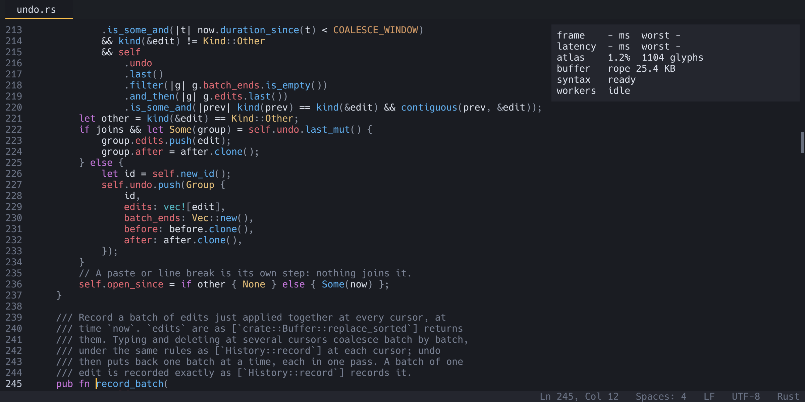

# Updates and troubleshooting

## Checking for updates

Nimbus asks GitHub once at each start, after the window appears, whether
a newer release exists. That is one HTTPS request to GitHub's API with a
`nimbus/X.Y.Z` user agent and nothing else; it says nothing unless a
newer release exists. Set `check_updates = false` in `config.toml` to
turn it off. Unattended runs (`--headless`, `--smoke`, `--screenshot`)
never check.

- **Check for Updates** (palette, or Help menu on macOS and Windows)
  runs the check now and says in the message line whether a newer
  release exists ("Nimbus 1.2.0 is available (you have 1.1.0)…") or
  that you are up to date. If GitHub cannot be reached within 10
  seconds, it says so.
- **Open Latest Release Page** opens the releases page in your browser.

## Installing an update

Nothing is downloaded until you ask.

1. After a check finds a newer release, run **Install Update** (palette
   or Help menu). Nimbus downloads the package for your system in the
   background; the message line shows how far it has got, and you can
   keep editing. **Cancel Update** stops it.
2. Before anything is unpacked, Nimbus proves the release is the
   owner's: the release's `SHA256SUMS` must carry a signature by the key
   built into Nimbus (the one in `minisign.pub`), the signature must name
   exactly that version, the version must be newer than yours, and the
   package must match its SHA-256 in the signed list. If any check
   fails, the download is deleted and the message line says why. A
   release with no signature is never installed.
3. When it says "Nimbus X.Y.Z is ready", run **Restart to Update**. It
   asks about unsaved tabs the way quitting does, puts the new version
   in place and starts it with your session. If you quit instead, the
   new version is put in place as Nimbus quits, and the next start is
   the new one.

Where the new version goes:

| Installed from | What Install Update does |
|---|---|
| The macOS zip or DMG (`Nimbus.app` you dragged to Applications) | Unpacks the new `Nimbus.app` beside it and swaps the two. A file Nimbus downloads itself is not quarantined, so there is no Gatekeeper prompt. |
| The Windows installer | Runs the new installer silently after Nimbus quits. It installs for your user only, so there is no administrator prompt, and it starts Nimbus again when asked to restart. |
| The AppImage | Replaces the AppImage file. |
| The Linux tarball | Replaces the `nimbus` binary, when its folder is writable. |
| Homebrew | Nothing: it tells you to run `brew upgrade --cask nimbus`, so Homebrew's record stays right. |
| Chocolatey | Nothing: it tells you to run `choco upgrade nimbus` from an administrator terminal, so Chocolatey's record stays right. |
| The `.deb` | Nothing: it tells you to install the new `.deb` with `sudo apt install ./nimbus_X.Y.Z_amd64.deb`. |
| A folder Nimbus cannot write, the Windows zip, or a build from source | Nothing: use Open Latest Release Page (or `git pull` and `cargo build` for a build from source). |

Your settings in the config folder are kept.

**Rolling back.** On macOS and Linux the version an update replaced is
kept beside the new one (`Nimbus.app.previous`, `nimbus.previous`) until
the next update. **Roll Back Update** puts it back at the next start
(or at once with Restart to Update). If a new version fails to open its
window, the next start puts the previous version back by itself and
says so. Windows keeps no previous version; install an older release
from the releases page instead.

## When a file changes on disk

Nimbus watches the files you have open and notices when another program
changes them.

| What happened | What Nimbus does |
|---|---|
| The file grew at its end, and you have no unsaved edits | Adds the new lines to the tab quietly: no message, no undo step, and the tab stays saved. **Follow Tail** appears in the status bar; see [Following a growing file](window.md#following-a-growing-file). |
| The file changed in any other way, and you have no unsaved edits | Reloads it, keeping your cursor on the same line, and says "changed on disk; reloaded". A file rewritten over and over reloads at most once a second. |
| The file changed, and you have unsaved edits | Marks the tab `(changed on disk)` and offers, in the palette: **Reload from Disk** (drop your edits), **Keep My Version** (saving overwrites the file), **Compare with Saved**, or **Merge with Disk** (see [Compare and merge](compare-and-merge.md#when-the-file-changes-on-disk-under-your-edits)). |
| The file was deleted | Marks the tab `(deleted)`. Your text is still in the tab, and saving recreates the file. Closing the tab asks whether to save, even with no edits, since it holds the only copy. |
| A huge, memory-mapped file changed | Does not reload by itself; run **Reload from Disk** to see the changes. If it grew, turn on **Follow Tail** to have new lines added as they arrive. |
| A huge, memory-mapped file got shorter | Reloads at once if you have no unsaved edits. Otherwise it warns you to run Reload from Disk straight away: reading the part of the file that disappeared can crash Nimbus. |

Your own saves never trigger these messages.

## Saving safely

Nimbus does not autosave or keep backup copies. Save often; unsaved
work is lost if Nimbus or your computer crashes. Saving itself is safe:
the new text is written to a temporary file beside yours and then
swapped in, so a crash during a save leaves the old file or the new
one, never a mix. If a save fails, a dialog says why and the tab
keeps its unsaved changes.

## Common problems

**A setting has no effect.** After editing `config.toml`, run "Reload
Config". If the message line shows a warning, it names the setting and
the problem; that one setting keeps its default. Query files (in
`queries/`) need a restart. `soft_wrap` applies to tabs opened after the
change.

**A key does nothing.** Your desktop or graphics driver may take it
first (see [Keyboard shortcuts](keybindings.md)); rebind it in `[keys]`.
After a reload, the message line also reports a key moved from one
command to another, a misspelt command id, or a key that cannot be
understood.

**`Alt+C` types a character instead of toggling match case.** The
find-bar keys apply only while the find bar is open.

**Go to Symbol is empty.** The file needs a syntax tree: a built-in
language with a symbol list, under 16 MB, and finished parsing. The
message line says which of these is missing.

**The status bar says "Compatibility mode".** Nimbus could not use the
graphics card (a virtual machine or remote desktop without one, or a
missing driver), so it draws on the CPU instead; the message says why.
Everything works as usual, and the frames look the same, though
scrolling a very large window can be less smooth. The F12 overlay's
`painter` line says which one is drawing.

**Nimbus will not start, or the window is blank or draws wrongly.** Run
it from a terminal to see the error. Nimbus draws with your graphics
card through Vulkan, Metal, DirectX 12 or OpenGL; if the default choice
does not work with your driver, try another, for example
`WGPU_BACKEND=gl nimbus` on Linux or `WGPU_BACKEND=dx12 nimbus` on
Windows. Or leave the graphics card out: `nimbus --compat`, or
`compat = true` in the [config](settings.md#top-level), draws on the
CPU.

**Accented letters look wrong (`é` for `é`, or `�`).** Nimbus guessed
the file's encoding wrong. Click the encoding in the status bar, choose
Reopen with Encoding, and pick the right one; to make it stick for
files like it, add them to `[encodings]` in `config.toml`. See
[Encodings and line endings](encodings.md).

**A save says a character is not in the encoding.** The file is in an
encoding such as Windows-1252 that has no bytes for a character you
typed. Remove it, or let Nimbus save the file as UTF-8 instead. See
[Saving](encodings.md#saving).

**A huge file says it is read-only.** It is 256 MB or more and in an
encoding other than UTF-8, which Nimbus does not convert at that size.
See [Huge files in another encoding](encodings.md#huge-files-in-another-encoding).

**Nimbus opens the wrong project, or old tabs.** Started with no
arguments, Nimbus reopens the last project you worked in, not the
folder your terminal is in. Name the folder (`nimbus .`) to open that
one, or name files to open just those. See
[Sessions](getting-started.md#sessions-picking-up-where-you-left-off).

**Starting over.** Delete `state.toml` from the config folder to forget
your sessions, recent files, the window's position and the sidebar's
size. To start once without reopening the last session (and without
replacing it), run `nimbus --no-session`. To try Nimbus with no
settings at all, start it with `NIMBUS_CONFIG_DIR` pointing at an empty
folder.

## If Nimbus quits unexpectedly

If Nimbus ever hits an internal error it cannot recover from, it writes
one line to `crash.log` in the config folder (beside `config.toml`) just
before it quits: the time, the version, where in Nimbus's code it
happened, and the error message. Nothing from your files is written to
it. The next time Nimbus starts it says so in the message line and
renames the record to `crash.log.old`. Please attach that file when you
report the problem.

Unsaved changes are lost in a crash: Nimbus does not keep copies of your
text anywhere you did not choose.

## Logs and the debug overlay

Nimbus writes a log to the terminal it was started from. `RUST_LOG`
controls how much: the default is `nimbus=info`, and
`RUST_LOG=nimbus=debug nimbus FILE` adds detail such as how long each
part of start-up took. Include the log when you report a problem.

**Toggle Debug Overlay** (`F12`) shows, in a corner of the window, how
long frames take, the delay from key press to screen, how full the glyph
cache is, how the file is held in memory, and what background work is
running. `--debug-overlay` shows it from the start.

