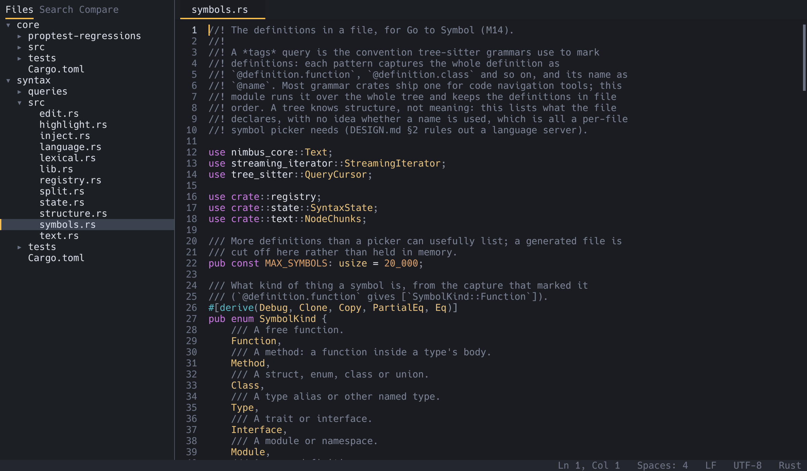
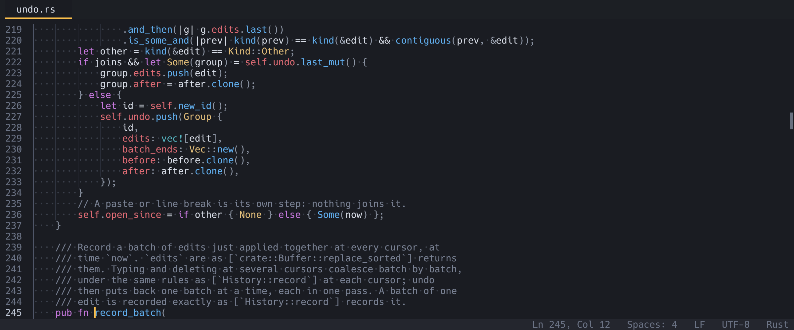

# The window

From top to bottom, a Nimbus window has a **tab strip**, an optional
**find bar**, the **text**, and a **status bar** along the bottom. The
**sidebar** sits on the left. You can also put up to three **groups** of
tabs side by side.

## Tabs

Every open file is a tab. The strip at the top shows each tab's file
name, a dot for unsaved changes, and a note when the file changed on disk
behind your back: `name (changed on disk)` or `name (deleted)` (see
[Updates and troubleshooting](troubleshooting.md#when-a-file-changes-on-disk)).
Each tab keeps its own cursor, scroll position and undo history.

| To | macOS | Windows and Linux |
|---|---|---|
| Switch to a tab | click it | click it |
| Next or previous tab | `Ctrl+Tab`, `Ctrl+Shift+Tab` | `Ctrl+Tab`, `Ctrl+Shift+Tab` |
| Go to tab 1 to 8 | `Cmd+1` … `Cmd+8` | `Ctrl+1` … `Ctrl+8` |
| Go to the last tab | `Cmd+9` | `Ctrl+9` |
| New untitled tab | `Cmd+N` or `Cmd+T` | `Ctrl+N` or `Ctrl+T` |
| Close the tab | `Cmd+W` | `Ctrl+W` |
| Reopen the tab you closed last | `Cmd+Shift+T` | `Ctrl+Shift+T` |

Opening a file that is already open in this group switches to its tab
rather than opening it twice; if it is open only in another group, you
get a second tab on the same text (see [Groups](#groups-tabs-side-by-side)).
When the only tab is an untouched untitled one, the
first file you open replaces it. Closing the last tab quits Nimbus.

**Reopen Closed Tab** brings back the most recently closed tab, with its
cursor and scroll position; press it again for the one before (up to 50
in one run). Untitled tabs cannot be reopened. When you quit, the open
tabs are remembered as the project's session (see
[Getting started](getting-started.md#sessions-picking-up-where-you-left-off)).

## The sidebar

The sidebar (`Cmd+B` / `Ctrl+B` to show or hide it) has three tabs in
its header, **Files**, **Search** and **Compare**, followed by the
project folder's name. Search is the Find in Files panel, described in
[Find and replace](find-and-replace.md#find-in-files). Compare holds the
compare options and a folder compare's results, described in
[Compare and merge](compare-and-merge.md#compare-options). Files is the
project tree:

- Folders come first, then files, both sorted without regard to case.
  A folder's contents are read the first time you open it, so even a
  huge repository costs nothing until you look inside.
- Files your `.gitignore` excludes are hidden, and so is the `.git`
  folder. Dotfiles are shown. "Show/Hide Ignored Files in Sidebar" in the
  palette shows the ignored files too (Find in Files follows the same
  setting).
- Click a folder to open or close it, click a file to open it. The
  active tab's file is highlighted, and the tree opens folders down to it
  when you switch tabs.
- The tree follows changes on disk: create, delete or rename files from
  a terminal and it updates within about a second. Only folders you have
  opened are watched.
- Drag the sidebar's right edge to resize it.

To use the tree from the keyboard, press `Cmd+Shift+E` / `Ctrl+Shift+E`
(Focus Sidebar), or click in it. Then Up and Down move, Page Up and Page
Down move a screen, Home and End go to the first and last row, Right
opens a folder (and steps into it when it is open), and Left closes a
folder (or goes to its parent). To open a file or toggle a folder, press
Enter on Windows and Linux, or `Cmd+Down` or Space on macOS, as in
Finder. Escape gives the keyboard back to the text. Typing does nothing
while the tree has focus.

### Working with files in the tree

The tree can create, rename and remove files:

| Command | Keys in the tree | What it does |
|---|---|---|
| New File in Tree… | (palette, menu) | Asks for a name and creates an empty file, then opens it. |
| New Folder in Tree… | (palette, menu) | Asks for a name and creates a folder. |
| Rename in Tree… | `F2` everywhere; also `Enter` on macOS | Renames the selected file or folder. |
| Move to Trash | `Delete`; also `Cmd+Backspace` on macOS | Moves the selected file or folder to the system's trash (the Recycle Bin on Windows), where you can restore it from. |
| Reveal in Finder / Explorer / File Manager | (palette, menu) | Shows the selected item in your system's file manager. On Linux it opens the folder holding it. With the sidebar hidden, it reveals the active tab's file. |

**Right-click** a row for a menu with all five, or run them from the
palette.

- A new file or folder goes into the selected folder, or next to the
  selected file, or at the top of the project when nothing is selected.
  A name can include folders, such as `src/util/new.rs`; missing folders
  are created. It cannot leave the project with `..`.
- The name is typed in a field right in the tree. Enter confirms and
  Escape cancels. Renaming starts with the name selected without its
  extension.
- Renaming onto a name that already exists asks before replacing it.
  Creating a file or folder that already exists is refused.
- Open tabs follow a rename: they keep their text, unsaved edits and
  undo history, and save under the new name. Recent files and closed
  tabs follow too.
- Moving a file to the trash closes its tabs. If one has unsaved
  changes, Nimbus asks first, since the trash keeps the file but not
  your edits.

**Drag and drop.** Drag a row onto a folder to move it there; hold
`Option` / `Alt` while dropping to copy it instead. Dropping below the
last row moves it to the top of the project. The folder under the
pointer is highlighted while you drag. Moving onto a name that already
exists asks first, and open tabs follow a moved file as they do a
rename. A copy into its own folder gets a new name such as `notes
copy.txt`.

**Undo Move** (palette, or the tree's right-click menu) takes back the
last move, copy or trash of this run, newest first. A move goes back
where it was and a copy is moved to the trash. Taking back a trash
restores the item on Linux and Windows; on macOS the trash cannot be
read back by a program, so use Finder's Put Back instead.

**Search in Folder** (right-click a folder) opens the Search panel with
that folder in its include field.

Dragging a file from Finder or Explorer onto the window opens it.
Dragging a folder adds it to the workspace.

### Workspaces: several folders at once



A workspace is the folders in the sidebar and the files you had open.
Nimbus remembers one per project folder by itself (see
[Sessions](getting-started.md#sessions-picking-up-where-you-left-off)).

- **Add Folder to Workspace…** (File menu or palette) shows another
  folder in the sidebar, as does dropping a folder on the window or
  naming several on the command line (`nimbus app lib`). With more than
  one, each folder is a row of its own. Go to File, Find in Files and
  the tree's operations cover them all, and paths are shown with the
  folder's name in front, such as `lib/src/x.rs`. A folder inside one
  already shown is refused.
- **Remove Folder from Workspace** takes out the folder holding the
  selected row. Its open tabs stay open. The first folder stays; it names
  the session.
- **Save Workspace As…** keeps the workspace under a name, in
  `workspaces/NAME.toml` in the config folder. **Open Workspace…** lists
  them, and `nimbus --workspace NAME` opens one.
- **Save Workspace Here** writes `.nimbus/workspace.toml` in the first
  folder instead, with paths relative to it, so the workspace travels
  with the project's repository. It is the only file Nimbus ever writes
  inside a project, and only when you run this command. Add `.nimbus/`
  to `.gitignore` unless the project should share it. Opening a folder
  that has one, when this computer has no session for it yet, shows a
  note offering **Open Project Workspace**. It never loads by itself.
  Because the file comes with whatever you cloned or unpacked, Open
  Project Workspace opens only what is inside that project: folders and
  files elsewhere (an absolute path, `../`, or a link pointing out of the
  project) are skipped, and the message line says how many. Use **Save
  Workspace As…** for a workspace whose folders are in several places.

A workspace file holds the folders, the sidebar's mode, the folders open
in the tree, the editor groups and the tabs. Settings stay in
`config.toml`:

```toml
# A Nimbus workspace: its folders and the files it had open.
roots = [".", "vendor/shared-lib"]
mode = "files"
expanded = ["src"]

[[tabs]]
path = "src/main.rs"
cursor = 120
scroll = 0
active = true
```

Whether the sidebar is shown, and how wide it is, are remembered between
runs in `state.toml` (see [Settings](settings.md#statetoml)); the folders
open in the tree are part of the project's session.

## The status bar and message line

The right side of the status bar describes the active tab. From left to
right, each item appears only when it applies:

| Item | Meaning |
|---|---|
| `3 cursors` | More than one cursor is active. |
| `12 selected` | Characters selected, across all cursors (a size such as `80 MB` for very large selections). |
| `Ln 120, Col 8` | The cursor's line and column. In a huge file, `Ln ~` means that line has not been counted yet. |
| `Spaces: 4` or `Tabs` | How Tab and Enter indent in this file. Click it to change it (see [Editing](editing.md#indentation)). |
| `LF` or `CRLF` | The file's line endings. Nimbus keeps whatever the file uses. Click it to change them (see [Line endings](encodings.md#line-endings)). |
| `UTF-8`, `UTF-8 BOM`, `UTF-16 LE`, `Windows-1252`, … | The encoding the file is read and saved in. Click it to reopen or save the file in another one (see [Encodings](encodings.md)). |
| `Not UTF-8` | The file is held as bytes: bytes that are not valid UTF-8 show as `�` and are written back unchanged unless you edit them. |
| `Read-only` | A huge file in another encoding, which Nimbus shows but does not convert (see [Encodings](encodings.md#huge-files-in-another-encoding)). |
| `Rust`, `Markdown`, … | The language used for highlighting. |
| `Counting lines 42%` | A huge file's lines are still being counted in the background. |
| `Follow Tail` or `Following` | The file has grown on disk since it was opened (a log being written, say). Click it to keep the view at the end as new lines arrive; it then reads `Following`. See [Following a growing file](#following-a-growing-file). |

In a compare or merge view the status bar also says where you are, such
as `change 3 of 12` or how many conflicts are left.

The left side is the **message line**: short notes such as "Saved",
"Replaced 3 matches" or "Soft wrap on", and warnings such as a mistake in
your config file. A message disappears after four seconds. Errors are
shown in the theme's error colour. When you press the first half of a
two-key shortcut such as `Cmd+K Cmd+0`, the status bar shows the first
key while it waits (two seconds) for the second.

## Following a growing file

When another program adds to the end of an open file, such as a log
being written, Nimbus adds just the new lines to the tab, as long as you
have no unsaved changes in it. The tab does not become unsaved, the new
text is not an undo step, and your cursor and scroll stay where they
are. The status bar then shows `Follow Tail`.

**Follow Tail** (click it in the status bar, or run it from the palette)
moves the cursor to the end and keeps it there as more lines arrive; the
status bar reads `Following`. Following stops when you scroll up, move
the cursor away from the end, add a cursor or edit the text; click the
item or run the command again to stop it yourself. It needs the file
without unsaved edits, and works for huge memory-mapped files too, which
otherwise do not pick up changes by themselves.

If the file is rewritten or replaced instead (a rotated log, for
example), Nimbus reloads it as described in
[Updates and troubleshooting](troubleshooting.md#when-a-file-changes-on-disk).

## Zoom, whitespace and indent guides



Zoom In (`Cmd+=` / `Ctrl+=`), Zoom Out (`Cmd+-` / `Ctrl+-`) and Reset
Zoom (`Cmd+0` / `Ctrl+0`) change the text size by one point at a time,
between 6 and 72. The top line on screen stays put. The size is
remembered for the next start unless `remember_zoom = false`; it is never
written to `config.toml`.

Spaces show as `·` and tabs as `→` inside a selection by default; Toggle
Render Whitespace in the palette cycles between selection, everywhere and
never. Toggle Indent Guides draws a thin line at each indentation level,
brighter for the level around the cursor. Both start from
`render_whitespace` and `indent_guides` in the [settings](settings.md).

Characters that would otherwise draw as nothing are always shown as a
red box in their cell, whatever the whitespace setting: the controls
that reorder right-to-left and left-to-right text (U+202A–202E,
U+2066–2069, U+200E, U+200F, U+061C) and zero-width characters such as
the zero-width space (U+200B), word joiner (U+2060), a byte order mark
inside the text (U+FEFF) and the soft hyphen (U+00AD). Code can use them
to read differently from what it does (the "Trojan Source" trick), or
to make two names that look the same differ. The zero-width joiner and
non-joiner are not marked, since emoji and many scripts need them. The
colour is the theme's `hidden_char`.

The scrollbar fades out a second after you stop scrolling, and comes back
when you scroll or point at it.

## Sticky scroll and the minimap

**Sticky scroll** keeps your place in a long file. When the line that
starts the function, impl, class or Markdown section you are reading
scrolls off the top, it stays pinned there, above the text, with the
scopes around it: up to five rows, outermost first. Click a pinned row
to jump to it. It works in every language with a syntax tree, so not in
files over 16 MB. It is on by default; turn it off with
`sticky_scroll = false` in the [settings](settings.md), or for the
session with Toggle Sticky Scroll in the palette.

The **minimap** is a narrow column at the right edge of the text that
draws the lines around the view as small coloured blocks, with a
lighter band over the lines on screen. Click in it to centre that line,
or drag the band to scroll. It is off by default: Toggle Minimap in the
palette shows it for the session, and `minimap = true` shows it from the
start. `minimap_width` sets its width in points. In a big file it shows
the few thousand lines around the view, not the whole file, so it costs
the same on a 4 GB log as on a small file.

## The Markdown preview

Open Preview (`Cmd+Shift+V` / `Ctrl+Shift+V`, or View > Open Preview) in
a Markdown file shows it as a formatted page in a group to the right:
headings, bold, italic and struck-through text, lists and task lists,
quotes, tables, links and code blocks. Code blocks are coloured by the
language their fence names, as in the editor. Images and HTML show as
`[image: …]` and `[HTML]` placeholders.

The keyboard stays in the file, so you can type and watch the page. It
updates once you pause typing for a moment, and scrolls along when you
scroll the file. You can also scroll the preview on its own with the
wheel, or click into it and use the arrow and page keys. Click a link to
open it: a web link opens in your browser, and a link to a file next to
this one opens it in Nimbus. The preview is read-only; it closes like
any tab, and comes back with your session.

The preview uses the `ui_font` when you set one, and the editor font
otherwise. Files over 16 MB are not previewed.

## Menus

On macOS and Windows, Nimbus has a menu bar: File, Edit, Selection, View
and Help (and the Nimbus application menu on macOS). On Windows Nimbus
draws it, and its menus, in the theme's colours: `F10` opens it from the
keyboard, the arrow keys move between items and menus, `Enter` runs an
item, a letter runs the first item starting with it, and `Esc` or a
click elsewhere closes it. A menu taller than the window scrolls: with
the mouse wheel, the arrow keys, or the ▲ and ▼ at its ends. The File menu also
has Open Recent, Reopen Closed Tab, Reopen Last Session, Save with Encoding and Reopen with Encoding. The menus run the
same commands as the keys and the palette, and show your current
shortcuts, including ones you changed in the config. Linux has no menu
bar; the command palette lists every command instead.

## Groups: tabs side by side

Split Right (`Cmd+\` / `Ctrl+\`) opens a new **group** to the right of
the current one, showing the same file. You can have up to three groups
side by side. Each group has its own tab strip, scrollbar and find bar.

- **The same file in two groups** is one document shown twice. Typing in
  one shows in the other at once, while each keeps its own cursors,
  selection, scroll and folds. Undo in either group undoes the
  document's last edit. Saving saves it once, and the unsaved-changes
  dot applies to both. Closing one of the two tabs never asks to save,
  since the other still shows the text.
- **Focus**: click in a group, or use Focus Left Group and Focus Right
  Group (`Cmd+Option+Left` and `Cmd+Option+Right` /
  `Ctrl+Alt+Left` and `Ctrl+Alt+Right`). Files opened from the sidebar,
  Go to File or a dialog open in the focused group. Only the focused
  group's cursor blinks.
- **Move Tab to Next Group** (palette) moves the current tab one group
  to the right, making a new group if there is room, or wrapping round to
  the first.
- **Close Group** (palette) closes every tab in the focused group,
  asking about unsaved changes as Close Tab does. A group also closes
  when its last tab does.
- **Resize** groups by dragging the divider between them. The scroll
  wheel scrolls whichever group is under the pointer.

Compare and merge tabs work in a group like any other tab. Groups, their
widths and each group's front tab are part of the
[session](getting-started.md#sessions-picking-up-where-you-left-off), so
a project reopens split the way you left it.

On some Linux desktops `Ctrl+Alt+Left` and `Ctrl+Alt+Right` switch
workspaces before Nimbus sees them; use the palette, or change the keys
(see [Settings](settings.md#key-bindings)).
